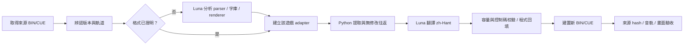

# 🎮 Game Skills — 特殊遊戲技能庫


> **選擇任務**　`[1] 新遊戲分析`　`[2] 繁中翻譯`　`[3] BIN/CUE 驗收`
>
> 將格式證據交給 adapter，把確定的位元組工作交給程式。

這是給 coding agent 使用的特殊遊戲 skill 集合。第一個 skill `saturn-localization` 協助建立 Sega Saturn 繁體中文工作流：Luna 負責格式分析與翻譯，Python 程式處理 bytes、容量、鏡像與可重現校驗。不同遊戲、版本都要各自確認格式，不能把一款遊戲的 parser 當成通用標準。

## 任務地圖



## 三步開始

1. 安裝所需 skill：

   ```bash
   npx skills add KarlSideProjects/game-skills --skill saturn-localization
   ```

   指定全域安裝也可用 `-g -a codex`（Codex）或 `-g -a claude-code`（Claude Code）。

2. 在 coding agent 中開啟 Saturn 漢化任務，要求使用 `$saturn-localization`，並提供自己合法取得的 BIN/CUE 與工程目錄。

3. 依 skill 提示先核對來源版本和格式，再決定分析、翻譯或建置。詳細 Agent 操作見 [`docs/agent-guide.md`](docs/agent-guide.md)。

## 內含內容

- `skills/saturn-localization/`：可安裝的 skill、通用工具與 Vandal Hearts English v1.4 專用 adapter。
- `docs/agent-guide.md`：Agent 執行步驟、分流與完成門檻。
- `skills/saturn-localization/references/`：disc、glyph、emulator provenance 與案例證據規則。

附帶的 Vandal Hearts 程式是版本專用範例，不包含遊戲 ROM、翻譯資料、素材、存檔或模擬器。實際 GUI 試玩命令只在配套外部遊戲工程存在且完成來源驗證時才適用；安裝此 repo 不會安裝模擬器或 ROM。

## 範例驗收範圍

Vandal Hearts English v1.4 案例曾驗收 v29 的冷開機選單、開場對話，以及首戰姓名／職業列。工程已靜態涵蓋全文、166 個 UI 欄位與 100 段影片字幕；其餘七段影片只有靜態覆蓋，自然 HardMode 解鎖未測，也未完整通關。這些結果只描述該案例，不是任何新遊戲的預設保證。交付二進位差異可在完全吻合來源 hash 時零模型呼叫重建；這不會重跑分析、提取或翻譯。

## 授權與第三方素材

本 repo 原創程式與文件採 [MIT License](LICENSE)，版權歸 KarlSideProjects，2026。沒有把第三方字型或遊戲素材打包進來。案例文件提及的 Fusion Pixel Font 依其 SIL Open Font License 1.1 單獨授權；使用或再散布該字型及衍生 bitmap 時，必須另行取得上游字型並保留其授權與版權聲明。
